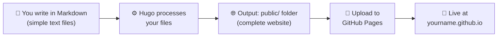
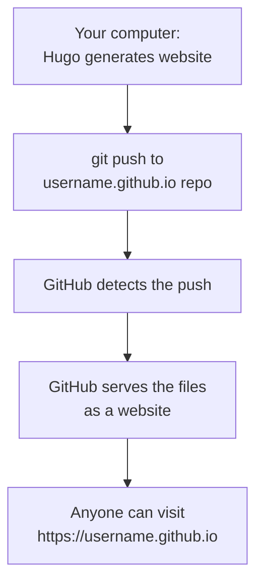
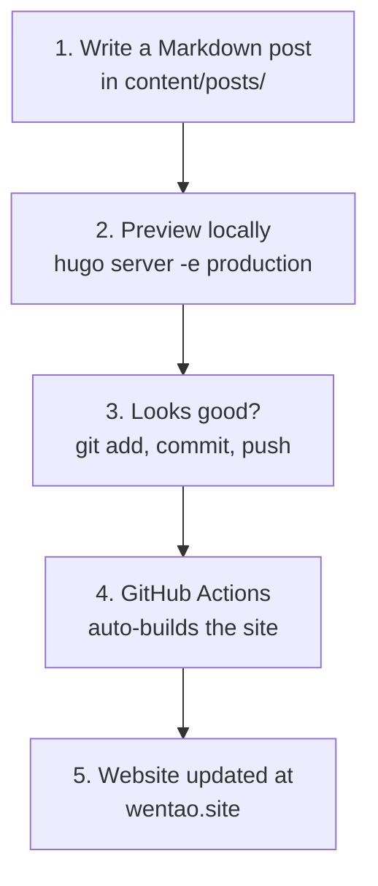
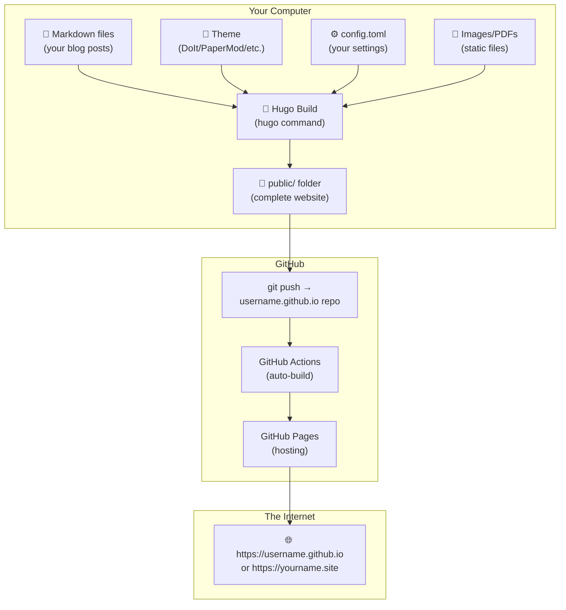

# 🌐 Complete Guide: Building an AI Research Website Like Yewentao's

> **Your goal**: Understand how Yewentao built [wentao.site](https://wentao.site) and create your own research showcase website using the same approach.

---

## Table of Contents

1. [What Are Static Pages?](#1-what-are-static-pages)
2. [What Is Hugo?](#2-what-is-hugo)
3. [What Are GitHub Websites (GitHub Pages)?](#3-what-are-github-websites-github-pages)
4. [How Yewentao's Website Works (The Big Picture)](#4-how-yewentaos-website-works-the-big-picture)
5. [What Does "Indexing Static Files" Mean?](#5-what-does-indexing-static-files-mean)
6. [What Are Hugo Themes?](#6-what-are-hugo-themes)
7. [How Everything Fits Together](#7-how-everything-fits-together)
8. [Step-by-Step: Build Your Own AI Research Website](#8-step-by-step-build-your-own-ai-research-website)
9. [Writing Your First Blog Post](#9-writing-your-first-blog-post)
10. [Advanced: Custom Domain Setup](#10-advanced-custom-domain-setup)
11. [What to Showcase as an AI Researcher](#11-what-to-showcase-as-an-ai-researcher)
12. [Adding a Comments System with Giscus](#12-adding-a-comments-system-with-giscus)
13. [Troubleshooting & Common Pitfalls](#13-troubleshooting--common-pitfalls)

---

## 1. What Are Static Pages?

### The Simple Analogy

Think of two kinds of restaurants:

| | **Dynamic Website** (e.g., WordPress) | **Static Website** (e.g., Hugo) |
|---|---|---|
| **Analogy** | A restaurant that cooks each dish **when you order** | A bakery that bakes everything **in advance** and just hands it to you |
| **How it works** | Every time someone visits, the server **runs code** to build the page from a database | All pages are **pre-built** as plain HTML files and just served directly |
| **Needs** | A database (MySQL), a backend language (PHP/Python), a running server | Just a folder of HTML/CSS/JS files — any file server works |
| **Speed** | Slower (must compute each page) | **Extremely fast** (just sends a ready-made file) |
| **Security** | Vulnerable (database injection, server exploits) | **Very secure** (no database, no backend code to exploit) |
| **Cost** | Usually paid hosting | **Free** (GitHub Pages, Netlify, etc.) |

### What "Static" Actually Means

**Static** = the content of the page **does not change based on who is viewing it or when**. The HTML file served to every visitor is identical. It was generated once, ahead of time.

This does NOT mean the page can't have:
- ✅ Animations, transitions, hover effects (these are client-side CSS/JS)
- ✅ Dark mode toggle
- ✅ Search functionality
- ✅ Comments (via third-party services like Disqus or Utterances)
- ✅ Beautiful, modern designs

It just means there's **no server-side computation** happening when someone visits your page.

### Why This Matters for Researchers

As a researcher, you want:
1. **Zero maintenance** — no server to manage, no database to update, no PHP patches
2. **Speed** — your papers and blog posts load instantly
3. **Free hosting** — GitHub Pages gives you unlimited free hosting
4. **Version control** — your entire website is a Git repository, so you have full history of every change
5. **Focus on writing** — you write in Markdown (simple text), not HTML

---

## 2. What Is Hugo?

### The One-Line Answer

**Hugo is a program that converts your Markdown text files into a complete, beautiful website.**

### The Detailed Explanation

Hugo is a **Static Site Generator (SSG)** — a tool that takes:

```
📝 Your content (Markdown files)
  +
🎨 A theme (design templates)
  +
⚙️ Configuration (your settings)
  ═══════════════════════════════
  ↓
🌐 A complete website (folder of HTML/CSS/JS files)
```

### How Hugo Works (Step by Step)



1. **You write content** in Markdown — a simple text format:
   ```markdown
   # My Paper Summary
   
   This paper proposes a new **attention mechanism** that...
   
   
   ```

2. **Hugo reads your Markdown** and wraps it in beautiful HTML templates (from your chosen theme)

3. **Hugo outputs a `public/` folder** containing the finished website — plain HTML, CSS, JS files

4. **You upload this folder** to GitHub Pages → your site is live!

### Why Hugo Specifically?

There are many static site generators (Jekyll, Gatsby, Next.js, etc.), but Hugo is popular because:

| Feature | Hugo |
|---------|------|
| **Speed** | Builds thousands of pages in < 1 second (written in Go) |
| **No dependencies** | Single binary, no Node.js/Ruby/Python required |
| **Themes** | Hundreds of beautiful themes available |
| **Multilingual** | Built-in support (Yewentao uses English + Chinese!) |
| **Learning curve** | Low — write Markdown, tweak config, done |

---

## 3. What Are GitHub Websites (GitHub Pages)?

### The Simple Explanation

**GitHub Pages** is a **free web hosting service** provided by GitHub. You push HTML files to a special repository, and GitHub automatically serves them as a website.

### How It Works



### The Magic Repository Name

The key is the **repository name**. If your GitHub username is `navin-research`, you create a repository called:

```
navin-research.github.io
```

GitHub automatically recognizes this naming pattern and serves whatever HTML files are in that repo as a website at `https://navin-research.github.io`.

### What You Get for Free

- ✅ **Free hosting** — no server costs, ever
- ✅ **HTTPS** — secure connection, automatically
- ✅ **Custom domain** — you can point `yourname.site` to it (like Yewentao uses `wentao.site`)
- ✅ **GitHub Actions** — automated builds (push Markdown → website updates automatically)
- ✅ **Global CDN** — fast loading worldwide

---

## 4. How Yewentao's Website Works (The Big Picture)

Let's trace exactly how Yewentao's website works, piece by piece:

### His Setup

| Component | What He Uses |
|-----------|-------------|
| **Static Site Generator** | Hugo |
| **Theme** | LoveIt → DoIt (the maintained successor) |
| **Hosting** | GitHub Pages |
| **Repository** | [yewentao256/yewentao256.github.io](https://github.com/yewentao256/yewentao256.github.io) |
| **Custom Domain** | wentao.site (optional — without it, it would be yewentao256.github.io) |
| **Deployment** | GitHub Actions (automatic) |

### His Repository Structure

```
yewentao256.github.io/
├── .github/workflows/    ← GitHub Actions: auto-builds & deploys when he pushes
├── archetypes/           ← Templates for new blog posts
├── config.toml           ← Hugo configuration (site title, author, menu, etc.)
├── content/
│   └── posts/            ← ALL his blog posts (Markdown files)
│       ├── pytorch/
│       │   └── deep_dive_to_autograd_2/
│       │       ├── index.en.md        ← English version of the post
│       │       ├── index.zh-cn.md     ← Chinese version of the post
│       │       └── resources/         ← Images for this post
│       │           └── graph.png
│       ├── nccl_summary/
│       └── ...
├── static/               ← Global static files (images, PDFs shared across posts)
│   └── csapp/
│       └── resources/
│           ├── ROP-attack.png
│           └── io-redirection.png
└── themes/               ← The Hugo theme (LoveIt/DoIt)
    └── DoIt/
```

### His Workflow (What He Does Day-to-Day)



### His Blog Content (What He Showcases)

Looking at his live site, he writes about:
- 📄 **Paper summaries** (NCCL, AWQ, PyTorch, SGLang, SARATHI, S4, MARLIN)
- 🔧 **Deep technical dives** (PyTorch autograd internals, CUDA)
- 📊 **Contributions** (vLLM bi-weekly journal)
- 🎤 **Presentations** (Batch Invariance in vLLM)

He organizes them into **categories** like `Paper_summary`, `Pytorch`, `Vllm`, `Presentation`.

---

## 5. What Does "Indexing Static Files" Mean?

> This is the FAQ you saw in Yewentao's README screenshot!

### What "Static Files" Means Here

In Hugo, **"static files"** = any file that is NOT a Markdown blog post. These are:
- 📸 Images (PNG, JPG, GIF, SVG)
- 📄 PDFs (your papers)
- 📊 Diagrams, charts
- 🎥 Videos
- Any other non-text asset

### What "Indexing" Means

**"Indexing"** here simply means **"referencing" or "linking to"** these files from within your Markdown blog posts. When you write a blog post and want to show an image, you need to tell Hugo **where to find that image file**. That's "indexing" it.

### The Two Methods Yewentao Describes

#### Method 1: Put Files Next to the Post (Relative Path) ✅ RECOMMENDED

Place images inside the same folder as your blog post:

```
content/posts/pytorch/deep_dive_to_autograd_2/
├── index.en.md          ← Your blog post
├── index.zh-cn.md       ← Chinese version
└── resources/           ← Images for THIS post only
    └── graph.png
```

Then reference it in your Markdown with a **relative path**:

```markdown

```

> [!TIP]
> **Why this is better**: The image travels with the post. If you move or rename the post, the image goes with it. Everything stays organized.

#### Method 2: Put Files in the Global `static/` Folder (Absolute Path)

Place images in the top-level `static/` directory:

```
static/
└── csapp/
    └── resources/
        ├── ROP-attack.png
        └── io-redirection.png
```

Then reference it from **any** blog post with an **absolute path** (starting with `/`):

```markdown

```

> [!NOTE]
> **When to use this**: For images shared across multiple posts, or for site-wide assets like your profile photo or logo.

### Summary

| Method | Where files go | How to reference | Best for |
|--------|---------------|-----------------|----------|
| **Method 1** (Relative) | Next to the post in `content/posts/...` | `` | Per-post images |
| **Method 2** (Absolute) | In top-level `static/` folder | `` | Shared/global images |

---

## 6. What Are Hugo Themes?

### The Simple Explanation

A **theme** is a pre-designed look-and-feel for your website. It defines:
- Layout (where the title, sidebar, content, footer go)
- Colors, fonts, spacing
- Features (search, dark mode, table of contents, code highlighting)
- Responsive design (mobile-friendly)

**You don't need to write any HTML or CSS**. You just pick a theme, and Hugo applies it to your Markdown content.

### Yewentao's Theme: LoveIt → DoIt

Yewentao uses the **LoveIt** theme (which was later forked and maintained as **DoIt**):

| Theme | URL | Status |
|-------|-----|--------|
| **LoveIt** | [github.com/dillonzq/LoveIt](https://github.com/dillonzq/LoveIt) | Original, now unmaintained |
| **DoIt** | [github.com/HEIGE-PCloud/DoIt](https://github.com/HEIGE-PCloud/DoIt) | Active fork, currently maintained |

Features of this theme:
- 🌓 Dark/light mode toggle
- 🔍 Full-text search
- 📋 Table of contents (auto-generated from headings)
- 🖥️ Code syntax highlighting with copy button
- 📊 Math equation support (LaTeX) — critical for AI research!
- 🌐 Multilingual support (English + Chinese, etc.)
- 💬 Comments integration
- 📱 Fully responsive (mobile-friendly)

### Other Great Themes for AI Researchers

| Theme | Style | URL |
|-------|-------|-----|
| **PaperMod** | Clean, minimal, fast | [github.com/adityatelange/hugo-PaperMod](https://github.com/adityatelange/hugo-PaperMod) |
| **Academic (Wowchemy)** | Academic portfolio + publications | [github.com/wowchemy/wowchemy-hugo-themes](https://github.com/wowchemy/wowchemy-hugo-themes) |
| **Stack** | Card-based, modern | [github.com/CaiJimmy/hugo-theme-stack](https://github.com/CaiJimmy/hugo-theme-stack) |
| **Blowfish** | Modern, animations | [github.com/nunocoracao/blowfish](https://github.com/nunocoracao/blowfish) |

---

## 7. How Everything Fits Together

Here's the complete picture of how Hugo + Themes + GitHub Pages work together:



### The Workflow in Plain English

1. **You write** a blog post in Markdown (just text with simple formatting)
2. **Hugo converts** your Markdown into beautiful HTML using your chosen theme
3. **You push** the code to your GitHub repository
4. **GitHub Actions** automatically runs Hugo and deploys the output
5. **GitHub Pages** serves the HTML to anyone who visits your URL
6. **(Optional)** You point a custom domain (like `yourname.site`) to GitHub Pages

---

## 8. Step-by-Step: Build Your Own AI Research Website

> [!NOTE]
> There are two ways to do this:
> - **Method A: From Scratch** (the original way — how Yewentao built his) ← **RECOMMENDED**
> - **Method B: Fork someone's repo** (shortcut — skip to the end of this section)
> 
> We'll go with Method A — building from scratch. This is how real developers do it.

### Prerequisites

You need:
- A **GitHub account** (free at github.com)
- **Git** installed on your computer (you likely already have this)
- **Hugo** installed on your computer

### Step 1: Install Hugo

```bash
# On Ubuntu/Debian (your system)
sudo apt install hugo

# Or, for the latest version (recommended):
sudo snap install hugo

# Verify installation
hugo version
```

> [!IMPORTANT]
> Make sure you have Hugo **extended** version (needed for SCSS/SASS support that many themes use). Check with `hugo version` — it should say "extended".

If snap doesn't give you extended version:
```bash
# Download the latest extended version from GitHub releases:
# https://github.com/gohugoio/hugo/releases
# Look for: hugo_extended_X.XXX.X_linux-amd64.deb
wget https://github.com/gohugoio/hugo/releases/download/v0.140.0/hugo_extended_0.140.0_linux-amd64.deb
sudo dpkg -i hugo_extended_0.140.0_linux-amd64.deb
```

### Step 2: Create a New Hugo Site FROM SCRATCH

```bash
# Create a brand new Hugo site (this is what Yewentao did originally)
hugo new site my-research-blog
cd my-research-blog
```

This creates a **clean, empty Hugo project** with this structure:

```
my-research-blog/
├── archetypes/         ← Templates for new posts
│   └── default.md      ← Default template (auto-created)
├── assets/             ← SCSS/CSS assets
├── content/            ← Your blog posts go here (EMPTY for now)
├── data/               ← Data files
├── i18n/               ← Translation files
├── layouts/            ← Custom layout overrides
├── static/             ← Static files (images, PDFs, etc.)
├── themes/             ← Themes go here (EMPTY for now)
└── hugo.toml           ← Main configuration file
```

**This is YOUR site. Fresh. Clean. No one else's content.**

### Step 3: Initialize Git

```bash
# Initialize a git repository
git init
```

### Step 4: Choose and Install a Theme

This is where you pick the look-and-feel of your site. You have options:

#### Option A: Use the DoIt Theme (same as Yewentao's — recommended)

```bash
# Add the DoIt theme as a git submodule
git submodule add https://github.com/HEIGE-PCloud/DoIt.git themes/DoIt
```

#### Option B: Use PaperMod (cleaner, very popular)

```bash
git submodule add https://github.com/adityatelange/hugo-PaperMod.git themes/PaperMod
```

#### Option C: Use Stack (card-based, modern)

```bash
git submodule add https://github.com/CaiJimmy/hugo-theme-stack.git themes/hugo-theme-stack
```

> [!TIP]
> **Why `git submodule`?** A submodule links to the theme's repository without copying all its code into yours. When the theme author updates their theme, you can pull the updates with `git submodule update --remote`.

### Step 5: Configure Your Site

Edit `hugo.toml` (or rename it to `config.toml` — both work) with your personal info.

**If you chose DoIt theme (like Yewentao):**

```toml
baseURL = "https://YOUR-USERNAME.github.io/"
title = "Your Name's Research Blog"
theme = "DoIt"
defaultContentLanguage = "en"

[params]
  version = "0.4.X"
  description = "AI Research Blog - Neural Networks, CUDA, Deep Learning"

  [params.home]
    [params.home.profile]
      enable = true
      title = "Your Name"
      subtitle = "AI Researcher | Neural Networks | CUDA"
      avatarURL = "/images/avatar.png"
      social = true

  [params.social]
    GitHub = "your-github-username"
    Email = "your-email@example.com"
    LinkedIn = "your-linkedin-id"

  # Enable math (LaTeX) — essential for research blogs!
  [params.page]
    [params.page.math]
      enable = true

[menu]
  [[menu.main]]
    identifier = "posts"
    name = "Posts"
    url = "/posts/"
    weight = 1
  [[menu.main]]
    identifier = "categories"
    name = "Categories"
    url = "/categories/"
    weight = 2
  [[menu.main]]
    identifier = "about"
    name = "About"
    url = "/about/"
    weight = 3

[markup]
  [markup.highlight]
    codeFences = true
    lineNos = true
    style = "monokai"
  [markup.goldmark]
    [markup.goldmark.renderer]
      unsafe = true   # Allows raw HTML in markdown
```

**If you chose PaperMod theme:**

```toml
baseURL = "https://YOUR-USERNAME.github.io/"
title = "Your Name's Research Blog"
theme = "PaperMod"

[params]
  ShowReadingTime = true
  ShowShareButtons = true
  ShowPostNavLinks = true
  ShowBreadCrumbs = true
  ShowCodeCopyButtons = true
  math = true

  [params.homeInfoParams]
    Title = "Your Name"
    Content = "AI Researcher | Neural Networks | CUDA | Deep Learning"

  [[params.socialIcons]]
    name = "github"
    url = "https://github.com/your-username"
  [[params.socialIcons]]
    name = "email"
    url = "mailto:your-email@example.com"

[menu]
  [[menu.main]]
    identifier = "posts"
    name = "Posts"
    url = "/posts/"
    weight = 1
  [[menu.main]]
    identifier = "about"
    name = "About"
    url = "/about/"
    weight = 2
```

### Step 6: Add Your Profile Photo

```bash
# Create the images directory
mkdir -p static/images

# Copy your photo there (replace with your actual photo path)
cp /path/to/your/photo.png static/images/avatar.png
```

### Step 7: Create Your First Blog Post

```bash
# Create a new post using Hugo's command
hugo new posts/my-first-research-post/index.md
```

This creates `content/posts/my-first-research-post/index.md`. Open it and write:

```markdown
---
title: "My First Research Post"
date: 2026-04-27
draft: false
description: "An introduction to my research work"
categories: ["Research"]
tags: ["neural-networks", "CUDA"]
math: true
---

# My Research on Custom Neural Network Frameworks

In this post, I'll walk through my work on building a custom
neural network framework from scratch with CUDA kernels...

## Architecture Overview


## Key Results

| Model | Accuracy | Training Time |
|-------|----------|---------------|
| GPT-2 | 94.2% | 3.2 hours |

## The Math

The attention mechanism computes:

$$
\text{Attention}(Q, K, V) = \text{softmax}\left(\frac{QK^T}{\sqrt{d_k}}\right)V
$$

## Code Snippet

```cuda
__global__ void attention_forward_kernel(...) {
    // Your CUDA kernel code
}
```
```

> [!TIP]
> **Adding images**: Create a `resources/` folder next to your post and put images there:
> ```
> content/posts/my-first-research-post/
> ├── index.md
> └── resources/
>     └── architecture.png
> ```

### Step 8: Create an About Page

```bash
hugo new posts/about/index.md
```

Edit `content/posts/about/index.md`:

```markdown
---
title: "About Me"
date: 2026-04-27
draft: false
---

Hello! Welcome to my blog!

## Contact
- Email: your-email@example.com
- GitHub: [your-username](https://github.com/your-username)
- LinkedIn: [Your Name](https://linkedin.com/in/your-id)

## Education
- Your degree, your university

## Research Interests
- Neural Networks, CUDA Programming, Deep Learning Systems

## Projects
- Custom Neural Network Framework in C++/CUDA
- ...
```

### Step 9: Preview Locally

```bash
# Start Hugo's built-in development server
hugo server -e production

# Open in browser: http://localhost:1313
```

You'll see your website live with **hot-reload** — every time you save a file, the browser updates instantly!

> [!NOTE]
> If you see no CSS/styling, make sure the `theme = "DoIt"` (or whichever theme name) in your `hugo.toml` exactly matches the folder name inside `themes/`.

### Step 10: Create Your GitHub Repository and Push

```bash
# Go to github.com/new and create a repo named: YOUR-USERNAME.github.io
# Then connect your local project to it:

git add .
git commit -m "Initial site: Hugo + DoIt theme from scratch"
git branch -M main
git remote add origin https://github.com/YOUR-USERNAME/YOUR-USERNAME.github.io.git
git push -u origin main
```

### Step 11: Set Up GitHub Actions for Auto-Deploy

1. Go to your repo on GitHub → **Settings** → **Pages**
2. Under **Source**, select **GitHub Actions**
3. Create the file `.github/workflows/hugo.yml`:

```bash
mkdir -p .github/workflows
```

Then create `.github/workflows/hugo.yml` with this content:

```yaml
name: Deploy Hugo site to Pages

on:
  push:
    branches: ["main"]

permissions:
  contents: read
  pages: write
  id-token: write

jobs:
  build:
    runs-on: ubuntu-latest
    steps:
      - uses: actions/checkout@v4
        with:
          submodules: recursive
      - name: Setup Hugo
        uses: peaceiris/actions-hugo@v3
        with:
          hugo-version: 'latest'
          extended: true
      - name: Build
        run: hugo --minify
      - name: Upload artifact
        uses: actions/upload-pages-artifact@v3
        with:
          path: ./public

  deploy:
    needs: build
    runs-on: ubuntu-latest
    environment:
      name: github-pages
      url: ${{ steps.deployment.outputs.page_url }}
    steps:
      - name: Deploy to GitHub Pages
        id: deployment
        uses: actions/deploy-pages@v4
```

```bash
git add .
git commit -m "Add GitHub Actions workflow for auto-deploy"
git push
```

### Step 12: Your Site Is Live! 🎉

Wait 1-2 minutes for GitHub Actions to build, then visit:
`https://YOUR-USERNAME.github.io`

**From now on, every time you write a new post and `git push`, your site updates automatically!**

---

### Alternative: Fork Method (Shortcut)

> If you want to skip the from-scratch setup, you can clone Yewentao's repo as a starting point. He explicitly invites this in his README ("welcome to fork and star").

```bash
# Clone Yewentao's repo
git clone https://github.com/yewentao256/yewentao256.github.io.git YOUR-USERNAME.github.io
cd YOUR-USERNAME.github.io

# Remove his git history
rm -rf .git

# Delete his content
rm -rf content/posts/*
rm -rf static/*

# Initialize as your own repo
git init
git remote add origin https://github.com/YOUR-USERNAME/YOUR-USERNAME.github.io.git

# Edit config.toml with your info, then push
git add .
git commit -m "My blog, based on Yewentao's template"
git branch -M main
git push -u origin main
```

> [!WARNING]
> The fork method gives you a working site faster, but you won't understand the structure as well. The from-scratch method teaches you what every file does.

---

## 9. Writing Your First Blog Post

### Markdown Quick Reference

Markdown is the language you write your posts in. Here's a cheat sheet:

```markdown
# Heading 1
## Heading 2
### Heading 3

**bold text**
*italic text*
`inline code`

- Bullet point 1
- Bullet point 2

1. Numbered item
2. Numbered item

[Link text](https://example.com)


> Blockquote for highlighting important text

| Column 1 | Column 2 |
|-----------|----------|
| Data      | Data     |

```python
# Code block with syntax highlighting
def train(model, data):
    ...
```

$E = mc^2$   ← Inline math (LaTeX)

$$
\frac{\partial L}{\partial w} = \sum_{i} x_i \cdot \delta_i
$$            ← Block math (LaTeX)
```

### Blog Post Structure (Front Matter)

Every Hugo post starts with **front matter** — metadata between `---` marks:

```markdown
---
title: "Deep Dive into PyTorch Autograd"
date: 2026-04-27T10:00:00+05:30
draft: false                          # Set to false when ready to publish
author: "Your Name"
description: "An in-depth analysis of..."
categories: ["PyTorch", "Deep Learning"]
tags: ["autograd", "backpropagation", "computational-graph"]
math: true                            # Enable LaTeX math rendering
---

Your content starts here...
```

### Adding Images to Your Post

```
content/posts/my-cuda-kernels/
├── index.en.md
└── resources/
    ├── kernel_performance.png
    ├── architecture.svg
    └── results_table.png
```

In your Markdown:
```markdown

```

---

## 10. Advanced: Custom Domain Setup

Like Yewentao has `wentao.site` instead of `yewentao256.github.io`:

### Step 1: Buy a Domain

Buy a domain from a registrar:
- **Namecheap** (~₹800/year for .site domains)
- **Google Domains** 
- **Cloudflare Registrar** (at-cost pricing, cheapest)
- **GoDaddy**

Good domain ideas for a researcher:
- `yourname.site`
- `yourname.dev`
- `yourname.io`
- `yourname-research.com`

### Step 2: Configure DNS

At your domain registrar, set up DNS records:

```
Type: CNAME
Name: www
Value: YOUR-USERNAME.github.io

Type: A
Name: @
Values: 
  185.199.108.153
  185.199.109.153
  185.199.110.153
  185.199.111.153
```

### Step 3: Tell GitHub About Your Domain

1. Go to your repo → **Settings** → **Pages**
2. Under **Custom domain**, enter your domain (e.g., `yourname.site`)
3. Check **Enforce HTTPS**

### Step 4: Update Hugo Config

```toml
baseURL = "https://yourname.site/"
```

---

## 11. What to Showcase as an AI Researcher

Looking at what Yewentao showcases, here's a tailored plan for you:

### Content Categories You Should Create

| Category | What to Write | Example Posts |
|----------|---------------|---------------|
| **Research** | Your own research work, experiments, results | "Building a Custom Neural Network Framework in C++/CUDA" |
| **Paper Summaries** | Summaries of important papers you've read | "Summary: Attention Is All You Need" |
| **Deep Dives** | Technical explanations of complex topics | "Deep Dive into CUDA Memory Hierarchy" |
| **Tutorials** | How-to guides for others | "How to Write Custom CUDA Kernels for Attention" |
| **Projects** | Showcasing your code projects | "My Custom Tensor Library: Design Decisions" |
| **Notes** | Learning notes on courses, books | "Notes on GPU Architecture for Deep Learning" |

### Your Specific Content (Based on Your Work)

From your open files, I can see you're working on:
- Custom neural network implementation in C++/CUDA
- Contiguous kernel implementations
- GPU-accelerated tensor operations
- Optimizer implementations (Adam, etc.)
- GPT-2 attention mechanisms

**Perfect blog post ideas for you:**

1. 🔥 **"Building a Neural Network Framework from Scratch in C++/CUDA"** — walkthrough of your framework
2. 🧮 **"Implementing Custom CUDA Kernels for Tensor Operations"** — your ContiguousKernel.cu work
3. ⚡ **"Optimizing GPU Memory: From Naive to Production-Grade Allocation"** — your tensor optimization work
4. 🧠 **"Implementing GPT-2 Attention in Raw CUDA"** — your gpt2_attn work
5. 📐 **"Understanding Tensor Contiguity: Why It Matters for Performance"** — your contiguity research

### Your Website Structure

```
About Page:
├── Your name, photo, university/affiliation
├── Research interests
├── Publications (with links to papers)
├── Contact: Email, GitHub, Google Scholar, LinkedIn

Blog Posts:
├── 📄 Paper Summaries (like Yewentao)
├── 🔧 Deep Technical Dives
├── 🧪 Experiment Results & Benchmarks
├── 📚 Tutorial & How-To Guides
└── 💡 Research Ideas & Notes
```

---

## 12. Adding a Comments System with Giscus

### What Is Giscus?

**Giscus** is a free, open-source comments system that lets visitors leave comments and emoji reactions on your blog posts. It is the same tool that Yewentao uses on his blog.

The clever part is that giscus does NOT need any database or server to store comments. Instead, it uses a feature built into GitHub called **GitHub Discussions** as its storage. So your comments live directly inside your own GitHub repository.

### Why Giscus Instead of Something Else?

There are many comment systems out there, but here is why giscus is the best choice for a Hugo + GitHub Pages site:

| Comment System | How It Stores Comments | Ads/Tracking | Cost | Best For |
|----------------|----------------------|--------------|------|----------|
| **Disqus** | Their own servers | Yes, shows ads on free plan | Free with ads, paid without | WordPress blogs |
| **Utterances** | GitHub Issues (older approach) | No | Free | Developers (but outdated) |
| **Giscus** | GitHub Discussions (modern) | No | Free | Static sites like ours |
| **WordPress** | Your own database + server | Depends | Paid hosting needed | WordPress only |
| **Facebook Comments** | Facebook servers | Yes | Free | Facebook-heavy audiences |

Giscus wins because:
- **Zero cost** forever
- **No ads**, no tracking, no cookies
- **No database needed** — everything lives in your GitHub repo
- **Dark mode support** — matches the DoIt theme automatically
- **Emoji reactions** — visitors can react with thumbs up, heart, party, etc.
- **You control everything** — you can moderate, edit, or delete comments directly from GitHub
- **Visitors need a GitHub account** to comment — this is actually good for a tech/research blog because your audience (developers, researchers) already has GitHub accounts

### How Giscus Works (Step by Step)

Here is exactly what happens when someone visits your blog post and writes a comment:

```
1. Visitor opens your blog post (e.g., "Building CUDA Kernels")
                    ↓
2. Giscus loads at the bottom of the page
                    ↓
3. Giscus asks GitHub: "Is there a Discussion for this post?"
                    ↓
4a. If YES → Giscus fetches all existing comments and shows them
4b. If NO  → Giscus waits (a Discussion will be created when the first comment arrives)
                    ↓
5. Visitor clicks "Sign in with GitHub" and types their comment
                    ↓
6. Giscus creates a new Discussion in YOUR repo's "Discussions" tab
                    ↓
7. The comment is now stored forever in your GitHub repo
                    ↓
8. Next visitor who opens the same post sees that comment automatically
```

So in simple words: **your GitHub repository becomes the database for your comments.**

### How Giscus Maps Posts to Comments

Giscus needs a way to know which comments belong to which blog post. It does this using a **mapping**. The most common mapping is `pathname`, which works like this:

| Your Blog Post URL | GitHub Discussion Title |
|--------------------|-----------------------|
| `/posts/cuda-kernels/` | `posts/cuda-kernels/` |
| `/posts/matrix-multiply/` | `posts/matrix-multiply/` |
| `/about/` | `about/` |

So each blog post gets its own separate Discussion thread. Comments on one post will never mix with comments on another post.

### What You Need to Set Up Giscus

To make giscus work on your site, you need **4 values** from GitHub:

| Value | What It Is | Where You Get It |
|-------|-----------|------------------|
| `dataRepo` | Your repo name (owner/repo format) | You already know this: `GOUTHAM1926/GOUTHAM1926.github.io` |
| `dataRepoId` | A unique ID that GitHub assigns to your repo | The giscus.app website gives you this |
| `dataCategory` | The Discussion category to use for comments | You create this in your repo (usually called "Comments") |
| `dataCategoryId` | A unique ID for that Discussion category | The giscus.app website gives you this |

These 4 values go into your `hugo.toml` config file, and the DoIt theme handles the rest automatically.

### Step-by-Step: Enable Giscus on Your Blog

#### Step 1: Create the GitHub Repository (if not done yet)

You need the `GOUTHAM1926.github.io` repository to exist on GitHub first. If you have not created it yet:
1. Go to [github.com/new](https://github.com/new)
2. Repository name: `GOUTHAM1926.github.io`
3. Set to **Public** (giscus only works on public repos)
4. Click **Create repository**

#### Step 2: Enable Discussions on Your Repo

1. Go to your repo page on GitHub: `https://github.com/GOUTHAM1926/GOUTHAM1926.github.io`
2. Click **Settings** (the gear icon tab)
3. Scroll down to the **Features** section
4. Check the box next to **Discussions**
5. Click **Save**

Now your repo has a new "Discussions" tab where comments will be stored.

#### Step 3: Create a "Comments" Category in Discussions

1. Click the **Discussions** tab in your repo
2. Click the **pencil icon** (edit categories) on the left sidebar
3. Click **New category**
4. Name it: **Comments**
5. Description: "Blog post comments powered by giscus"
6. Discussion Format: Choose **Announcement** (this means only giscus bot can create new threads, visitors can only reply — keeps things clean)
7. Click **Create**

#### Step 4: Install the Giscus App on GitHub

1. Go to [github.com/apps/giscus](https://github.com/apps/giscus)
2. Click **Install**
3. Choose **Only select repositories** and pick `GOUTHAM1926.github.io`
4. Click **Install**

This gives giscus permission to create Discussions in your repo on behalf of visitors.

#### Step 5: Get Your Config Values from giscus.app

1. Go to [giscus.app](https://giscus.app)
2. Under **Repository**, type: `GOUTHAM1926/GOUTHAM1926.github.io`
3. If everything is correct, you will see a green checkmark saying "Success! This repository meets all of the above criteria."
4. Under **Discussion Category**, select **Comments** (the one you just created)
5. Under **Page ↔ Discussions Mapping**, select **Discussion title contains page pathname**
6. Scroll down — giscus will show you a `<script>` tag with your config values

From that script tag, copy these 4 values:
- `data-repo` → this goes into `dataRepo`
- `data-repo-id` → this goes into `dataRepoId`
- `data-category` → this goes into `dataCategory`
- `data-category-id` → this goes into `dataCategoryId`

#### Step 6: Add Giscus Config to hugo.toml

Open your `hugo.toml` file and add this section at the bottom:

```toml
# Comment system using Giscus (powered by GitHub Discussions)
[params.page.comment]
  enable = true
  [params.page.comment.giscus]
    enable = true
    dataRepo = "GOUTHAM1926/GOUTHAM1926.github.io"
    dataRepoId = "PASTE_YOUR_REPO_ID_HERE"          # from giscus.app
    dataCategory = "Comments"
    dataCategoryId = "PASTE_YOUR_CATEGORY_ID_HERE"   # from giscus.app
    dataMapping = "pathname"
    dataStrict = "0"
    dataReactionsEnabled = "1"
    dataEmitMetadata = "0"
    dataInputPosition = "bottom"
    lightTheme = "light"
    darkTheme = "dark"
    dataLang = "en"
    dataLoading = "lazy"
```

Replace the two `PASTE_YOUR_..._HERE` values with the actual values you got from giscus.app in Step 5.

#### Step 7: Test Locally

Run `hugo server` and open a blog post in your browser. Scroll to the bottom — you should see the giscus comment box. If you are running locally (`localhost:1313`), giscus may show a warning that the origin does not match. This is normal and will work perfectly once you push to GitHub and the site goes live at `goutham1926.github.io`.

### What Each Config Value Means

| Config Key | What It Does |
|------------|-------------|
| `enable` | Turns giscus on (`true`) or off (`false`) |
| `dataRepo` | Your GitHub repo in `owner/repo` format |
| `dataRepoId` | Unique ID of your repo (GitHub assigns this internally) |
| `dataCategory` | Name of the Discussion category (we created "Comments") |
| `dataCategoryId` | Unique ID of that category |
| `dataMapping` | How to match a blog post to a Discussion (`pathname` = use the URL path) |
| `dataStrict` | `"0"` = fuzzy matching, `"1"` = exact match only |
| `dataReactionsEnabled` | `"1"` = allow emoji reactions (👍 ❤️ 🎉 etc.) |
| `dataEmitMetadata` | `"0"` = do not send extra metadata (keep it simple) |
| `dataInputPosition` | `"bottom"` = comment box appears below existing comments |
| `lightTheme` | Theme used when your site is in light mode |
| `darkTheme` | Theme used when your site is in dark mode |
| `dataLang` | Language for the giscus interface (`"en"` = English) |
| `dataLoading` | `"lazy"` = only load giscus when the visitor scrolls down to it (saves bandwidth) |

### Where Do Comments Actually Live?

After someone leaves a comment on your blog, you can see it in two places:
1. **On your website** — at the bottom of that blog post (visible to everyone)
2. **On GitHub** — go to your repo → click the **Discussions** tab → you will see a thread for each blog post that has received comments

You can edit, delete, pin, or lock any Discussion directly from GitHub. You are the repo owner, so you have full control.

## 13. Troubleshooting & Common Pitfalls

While setting up a Hugo + GitHub Pages site, it is easy to run into a few common configuration errors. Here are the most frequent ones and exactly how to fix them:

### Pitfall 1: "DNS check unsuccessful" on Custom Domain

**The Error:**
In your GitHub repo `Settings -> Pages`, you type a domain (like `goutham1926.site`) into the "Custom domain" box, hit Save, and GitHub throws a red error:
`Both goutham1926.site and its alternate name are improperly configured. Domain's DNS record could not be retrieved.`

**Why It Happens:**
GitHub provides the *hosting* for free, but it does NOT provide `.site`, `.dev`, or `.com` domain names for free. If you just type a domain name into that box, GitHub will try to connect to it, but the global internet registry (ICANN) will reject it because you haven't purchased it.

**How to Fix It:**
1. If you don't want to pay for a domain: Click **Remove** next to the custom domain box and leave it blank. Your free URL (`https://goutham1926.github.io`) will instantly start working again.
2. If you want the domain: You must go to a registrar (like Namecheap or GoDaddy), pay for it (~$2-$15/year), and configure the DNS settings (as detailed in [Section 10](#10-advanced-custom-domain-setup)).

### Pitfall 2: Website 404 Error (Because Repo is Private)

**The Error:**
You push all your code, you go to `https://yourname.github.io`, and you see a **404 Page Not Found** error saying *"There isn't a GitHub Pages site here."*

**Why It Happens:**
On a free GitHub account, **GitHub Pages only works for Public repositories**. If your repository is set to Private, GitHub completely disables the website hosting feature (unless you pay for GitHub Pro).

**How to Fix It:**
1. Go to your repository **Settings**.
2. Scroll to the very bottom to the **Danger Zone**.
3. Click **Change visibility** and set it to **Public**.
4. Go to **Settings -> Pages** and ensure the Source is set to **GitHub Actions**. Wait 30 seconds, and your site will be live.

### Pitfall 3: Author Name Missing from Footer

**The Error:**
You set `author = true` in `[params.footer]`, but the footer just shows `© 2026 | CC BY-NC 4.0` without your name.

**Why It Happens:**
Hugo and its themes are very strict about where configuration blocks go in `hugo.toml`. If you put `[author]` at the root level of your file, Hugo understands it, but the **DoIt theme specifically looks inside the `params` block**.

**How to Fix It:**
You must name the block `[params.author]`, not just `[author]`.

❌ **Wrong:**
```toml
[author]
  name = "Gautam Kumar Reddy K"
```

✅ **Correct:**
```toml
[params.author]
  name = "Gautam Kumar Reddy K"
  email = "your-email@example.com"
  link = "https://github.com/your-username"
```

---

## Quick Reference: Essential Commands

```bash
# Create new post
hugo new posts/my-post-title/index.en.md

# Preview locally (with drafts)
hugo server -D

# Preview locally (production mode, like Yewentao does)
hugo server -e production

# Build the site (generates public/ folder)
hugo --minify

# Deploy (just push to GitHub, Actions handles the rest)
git add .
git commit -m "New post: my-post-title"
git push
```

---

## Summary: The Complete Picture

```
You write Markdown → Hugo converts to HTML → GitHub hosts it → World sees it

         📝                  🔧                  🚀               🌐
   (simple text)      (automated tool)     (free hosting)    (your website)
```

> [!TIP]
> **The fastest path to get started**: Fork Yewentao's repo, delete his content, update `config.toml` with your info, write your first post, push to GitHub. You'll have a live website in under 30 minutes!

> [!IMPORTANT]
> **Start writing now.** The website itself takes 30 minutes to set up. The real value is in the content. Your CUDA kernel work, your custom framework, your paper insights — that's what will impress people. The tool (Hugo) is just the delivery mechanism.
